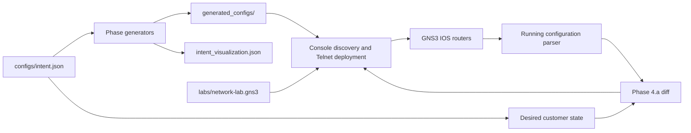
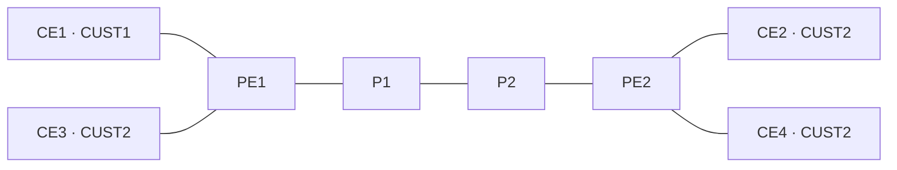

# Network Configuration Automation

Python automation for an academic Cisco IOS MPLS L3VPN lab in GNS3. A JSON intent describes the topology, addressing and customer services. The tool generates router configurations, deploys them through GNS3 Telnet consoles, and partially reconciles customer configuration with the running state.

## Project Overview

The supplied lab has four provider routers (`PE1–P1–P2–PE2`) and four customer edge routers, with two customer VRFs. Configuration generation works offline; deployment requires a running GNS3 lab and compatible IOS images.

## Academic Context

Developed as a university networking project at INSA Lyon, Telecommunications department. The original `NAS` repository history and contributor attribution are preserved. This is a student lab implementation; no production deployment or performance benchmark is claimed.

## Problem Statement

Configuring addressing, OSPF, MPLS, BGP and VRFs manually across several routers makes repeated lab experiments slow and prone to inconsistencies. An explicit intent model provides one source for deterministic configuration generation and a limited comparison with existing router state.

## Features

| Phase | Implemented behavior |
| --- | --- |
| 0 — Provider setup | Allocate `/30` core links and `/32` loopbacks; configure interfaces, OSPFv2 and router IDs. |
| 1 — MPLS | Enable CEF, LDP and MPLS on designated core interfaces. |
| 2 — VPN transport | Configure loopback-based iBGP between PEs, the `vpnv4` address family and community exchange. |
| 3 — Customers | Create VRFs with RD/RT values, attach PE–CE interfaces, configure eBGP, and advertise customer LANs, CE loopbacks and PE–CE prefixes. |
| 4.a — Partial reconciliation | Parse running configurations and generate targeted changes for PE VRFs/customer interfaces and CE interfaces/BGP, including CE AS changes. |

The tool also merges phase outputs into full configurations, exports addressing as JSON, discovers console ports from the `.gns3` file, retries console operations, and runs router jobs in parallel. Deployment modes are mutually exclusive; a failed reset or phase stops subsequent stages.

## Technologies

Python, JSON, GNS3/Dynamips, Cisco IOS console commands, IPv4, OSPFv2, MPLS/LDP, MP-BGP `vpnv4`, eBGP and VRFs. The Python standard library implements the generators and console workflow. Python 3.13+ additionally needs `standard-telnetlib`, declared in `requirements.txt`, because [Python removed `telnetlib`](https://docs.python.org/3/library/telnetlib.html).

## Architecture





Configuration paths are resolved from the repository, independently of the shell working directory. The original JSON keys, including `routeurs`, remain compatible with the existing intent model.

## Installation

Python 3.10+ is needed by the code; local verification covered Python 3.12 and 3.14. On Fedora, from the repository directory:

```bash
python3 -m venv .venv
source .venv/bin/activate
python -m pip install -r requirements-dev.txt
```

Generation needs no GNS3 server. Deployment requires GNS3/Dynamips and lawfully obtained IOS images. The supplied topology references a Cisco 7200 IOS image; no image or runtime files are distributed. Import `labs/network-lab.gns3` and adapt image paths and console ports to your local lab.

## Usage

Generate all phases and full configurations without contacting routers:

```bash
python config_auto.py
python config_auto.py --help
```

Edit `configs/intent.json` to change the lab intent. Outputs go to the ignored `generated_configs/` directory and `intent_visualization.json`. A representative generated PE configuration is included in [`examples/PE1_full.cfg`](examples/PE1_full.cfg).

Deploy into a disposable lab:

```bash
python config_auto.py --push-phases --project labs/network-lab.gns3
python config_auto.py --push-full PE1 --project labs/network-lab.gns3
python config_auto.py --push-full ALL --project labs/network-lab.gns3 --workers 4
```

Full/phased deployments erase targeted startup configurations. `--push-phases` and `--push-full ALL` also remove saved Dynamips runtime files under the selected project's directory. A single-router full push only resets its target. The reset does not reload routers or guarantee that an old running configuration is empty.

For the implemented incremental customer workflow:

```bash
python config_auto.py --reconcile-phase4a ALL --project labs/network-lab.gns3
python telnet_push.py PE1 --suffix full --project labs/network-lab.gns3
```

Reconciliation can remove VRFs, interfaces or BGP settings absent from the intent. Use it only where the intent owns those lab resources. Telnet is unencrypted and intended for isolated local consoles. If an enable password is required, set `GNS3_ENABLE_PASSWORD` in the shell; `--enable-pass` remains supported.

## Project Structure

```text
network_automation/   Generation, desired state, reconciliation and Telnet modules
configs/              Lab intent
labs/                 GNS3 topology, without IOS images
examples/             Reviewed lab configuration example
docs/                 Audit, migration and verification notes
tests/                Offline protocol, reconciliation and deployment-scope tests
config_auto.py         Main command, retained for compatibility
telnet_push.py         Manual deployment command, retained for compatibility
```

The other original executable script names remain as small entry points; implementations live in `network_automation/`.

## Verification

GitHub Actions runs the tests, Ruff lint and formatting checks on pushes and pull requests, using Python 3.12.

```bash
python -m pytest -q
ruff check .
ruff format --check .
```

Offline tests cover address allocation, protocol output, console discovery, reconciliation stability, CE AS changes, shutdown interfaces, and single-router reset scope. During migration, all 24 generated phase/full files were compared with the original tracked outputs and were byte-for-byte identical.

## Limitations

- Phase 4.a does not reconcile the whole provider core or all possible IOS services. Its parser supports only the implemented configuration subset.
- Intent flags such as `bgp.enabled` and `mpls.enabled` are not general feature switches; the generators implement the supplied phased lab assumptions.
- Console deployment uses prompt heuristics and does not validate every IOS command response. Router job failures stop the deployment stage and produce a failing exit status, but completion still does not prove routing convergence.
- Address allocation and interface assumptions are designed for this small IPv4 topology.
- Live deployment, routing convergence and connectivity were not verified during this migration because GNS3 and IOS runtime images were unavailable.
- Publication rights and licensing must be confirmed with the contributors before adding a license. None has been invented.
